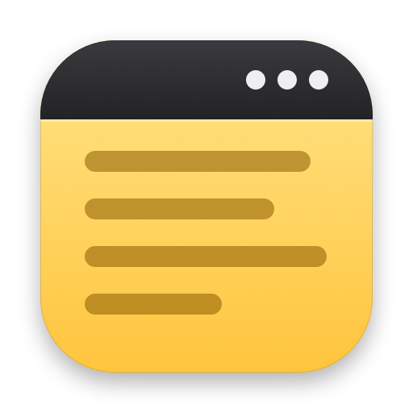

<p align="center">
  
</p>

<h1 align="center">MenuNote</h1>

<p align="center">A simple plain-text note, right in your Mac's menu bar.</p>

<p align="center">
  
</p>

## Features

- **Click the menu bar icon** to open a small, resizable note window. Click again to close it.
- **Press Esc** to save and close.
- **Global hotkey** (default <kbd>⌃N</kbd>) toggles the note from anywhere.
- **Right-click the icon** or click **•••** in the note window for About, Settings and Quit.
- **Settings:** choose the note file's location, the hotkey, and the font.
- Saved automatically as a plain `.txt` file. Move it into a synced folder (e.g. iCloud Drive) to sync it yourself.
- Sandboxed, with no network access.

## Install

1. Download `MenuNote-<version>.zip` from [Releases](../../releases) and unzip it.
2. Move `MenuNote.app` to `/Applications` and open it.
3. MenuNote isn't notarized by Apple yet, so macOS will block the first launch. Go to
   **System Settings › Privacy & Security**, scroll down, and click **Open Anyway**.

To start MenuNote at login, add it under **System Settings › General › Login Items**.

Requires macOS 15.7 or later.

## Where's my note?

By default the note is stored inside MenuNote's sandbox container:

```
~/Library/Containers/fredsted.co.MenuNote/Data/Documents/MenuNote.txt
```

Use **Settings › Move To…** to keep it somewhere else, or **Open Existing…** to use a text file you already have.

## Building

Open `MenuNote.xcodeproj` in Xcode and run the **MenuNote** scheme.

`./make-release.sh` builds a Release, ad-hoc signs it, and writes `dist/MenuNote-<version>.zip` for a GitHub release.
